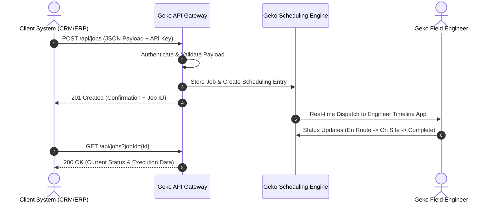
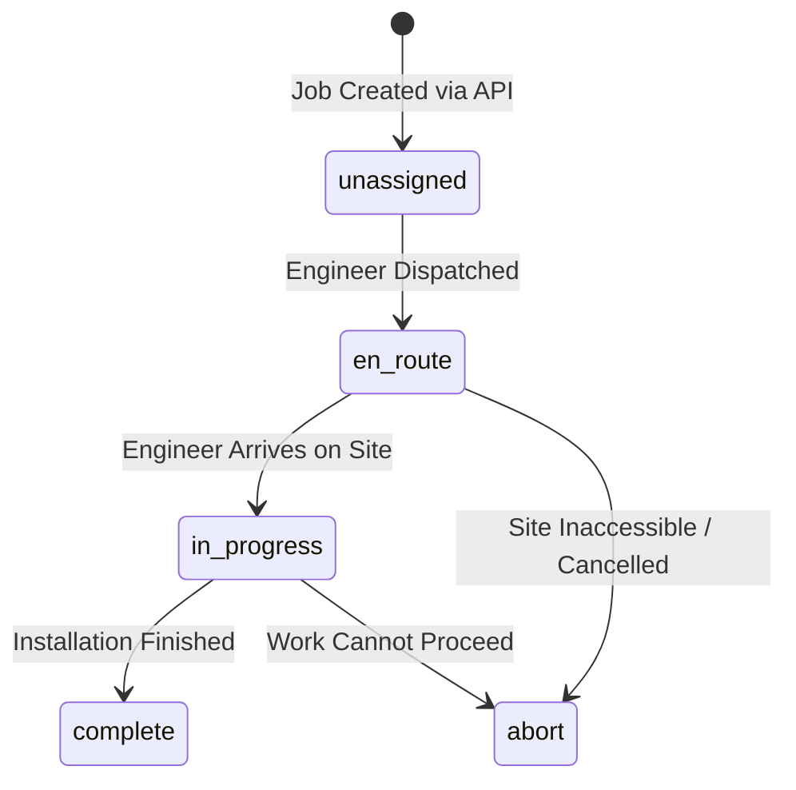

# Geko Scheduling Platform — External Jobs API Specification
**Enterprise REST Integration Guide**

---

| Document Information | Details |
|---|---|
| **API Version** | `v1.0 (REST)` |
| **Protocol** | `HTTPS (TLS 1.3 / 1.2)` |
| **Base URL** | `https://geko-scheduling.vercel.app/api` |
| **Target Audience** | Client Integration Engineers, Technical Product Managers, System Architects |
| **Status** | Production Ready |
| **Format** | JSON (`application/json; charset=utf-8`) |

---

## 1. Executive Overview

The **Geko Jobs Integration API** provides a direct, programmatic bridge between client-side ERP/CRM/order-management platforms and the Geko Field Scheduling & Operations Engine. 

By integrating with this endpoint, your systems can:
1. **Automate Job Dispatch**: Ingest new customer work orders directly into the Geko schedule without manual Excel/CSV uploads.
2. **Synchronise Lifecycle Data**: Retrieve real-time progress, engineer status updates, and completion timestamps.
3. **Geo-Location Integration**: Supply postcodes and addresses that feed directly into Geko’s route optimisation and engineer travel calculations.



---

## 2. Authentication & Security

All API transactions are encrypted via HTTPS and authenticated using an API Key mechanism.

### Required HTTP Headers

Every request sent to the Geko API must include the following headers:

```http
Content-Type: application/json
X-API-Key: Pingu202020!&
```

> [!IMPORTANT]
> - Treat your API Key as a sensitive secret. Never embed it in client-side code (browser JavaScript, public mobile app frontends) or public repositories.
> - If an API Key is lost or compromised, contact your Geko account manager immediately for instant key revocation and rotation.

### Live vs. Sandbox

Two keys are issued per integration:

| Key Type | Purpose | Data |
|---|---|---|
| **Live Key** | Production traffic. | Reads/writes real jobs — visible to engineers and on the live schedule. |
| **Sandbox Key** | Integration testing. | Reads/writes an isolated sandbox dataset. Never touches production job numbering or schedules. |

Every response (both `POST` and `GET`) includes an `environment` field (`"live"` or `"sandbox"`) so you can confirm which one you're hitting. There is no separate hostname or path for sandbox traffic — simply present your Sandbox Key instead of your Live Key against the same `https://geko-scheduling.vercel.app/api/jobs` endpoint.

---

## 3. Endpoints Reference

---

### 3.1 Create / Ingest a Job

Creates a new job in the Geko Scheduling platform. Once created, the job is immediately available for automatic dispatch, manual slot allocation, or route planning.

- **Method**: `POST`
- **Path**: `/api/jobs`
- **Authentication**: Required (`X-API-Key`)

#### Request Body Schema

| Field Name | Type | Required | Description | Constraints / Examples |
|---|---|---|---|---|
| `jobId` | `string` | Optional | Your system's unique identifier/reference number for this specific job/visit. If omitted, Geko will auto-assign a unique ID (`JOB-XXXXX`). | Max 64 chars. e.g. `ORD-2026-0881` or `J-0D5C3407` |
| `projectId` | `string` | Optional | Your system's reference for the overall customer project. Use the same `projectId` across several jobs (e.g. a survey visit, then an install visit, then an aftercare visit) to group them for one customer — see [3.3](#33-retrieve-all-jobs-for-a-project). | e.g. `PRJ-88410` |
| `title` | `string` | Optional | Customer salutation or title. | `Mr`, `Mrs`, `Ms`, `Dr`, `Prof` |
| `firstName` | `string` | Optional | Customer first name. | `Eleanor` |
| `lastName` | `string` | Optional | Customer surname. | `Rigby` |
| `addressLine1` | `string` | Optional | Primary street name and building/door number. | `42 Penny Lane` |
| `town` | `string` | Optional | Town or city name. | `Liverpool` |
| `postcode` | `string` | **Required** | UK postal code. Used for geocoding and travel estimation. | Valid UK format, e.g. `L18 1DG` |
| `phone` | `string` | Optional | Customer telephone or mobile number. | `07812 345678` |
| `email` | `string` | Optional | Customer email address. | `customer@domain.com` |
| `jobType` | `string` | **Required** | Work category. Must be either `Solar Install` or `Battery Only`. | `Solar Install` or `Battery Only` |
| `jobLength` | `string` / `number` | Optional | Expected duration of the installation in days. Defaults to `1` or `2` based on specification. | `1`, `2` |
| `jobDate` | `string` | Optional | Target installation date. | Format: `DD/MM/YYYY` or `YYYY-MM-DD` (e.g. `27/08/2026`) |

#### Example Request (`POST /api/jobs`)

```http
POST /api/jobs HTTP/1.1
Host: geko-scheduling.vercel.app
Content-Type: application/json
X-API-Key: Pingu202020!&

{
  "jobId": "ORD-2026-0881",
  "projectId": "PRJ-88410",
  "title": "Mrs",
  "firstName": "Eleanor",
  "lastName": "Rigby",
  "addressLine1": "42 Penny Lane",
  "town": "Liverpool",
  "postcode": "L18 1DG",
  "phone": "07812 345678",
  "email": "eleanor.rigby@example.com",
  "jobType": "Solar Install",
  "jobLength": "2",
  "jobDate": "27/08/2026"
}
```

#### Success Response (`201 Created`)

```json
{
  "success": true,
  "message": "Job created successfully.",
  "jobId": "ORD-2026-0881",
  "environment": "live"
}
```

---

### 3.2 Retrieve Job Status & Details

Fetches the complete dataset for a specific job, including live execution status, address combinations, and scheduling details.

- **Method**: `GET`
- **Path**: `/api/jobs?jobId={jobId}`
- **Authentication**: Required (`X-API-Key`)

#### Query Parameters

| Parameter | Type | Required | Description |
|---|---|---|---|
| `jobId` | `string` | **Required** | The unique Job Identifier to retrieve (e.g. `ORD-2026-0881` or `J-0D5C3407`). |

#### Example Request (`GET /api/jobs?jobId=ORD-2026-0881`)

```http
GET /api/jobs?jobId=ORD-2026-0881 HTTP/1.1
Host: geko-scheduling.vercel.app
X-API-Key: Pingu202020!&
```

#### Success Response (`200 OK`)

```json
{
  "success": true,
  "job": {
    "jobId": "ORD-2026-0881",
    "projectId": "PRJ-88410",
    "title": "Mrs",
    "firstName": "Eleanor",
    "lastName": "Rigby",
    "customerName": "Mrs Eleanor Rigby",
    "address": "42 Penny Lane, Liverpool",
    "addressLine1": "42 Penny Lane",
    "town": "Liverpool",
    "postcode": "L18 1DG",
    "phone": "07812 345678",
    "email": "eleanor.rigby@example.com",
    "jobType": "Solar Install",
    "jobLength": "2",
    "jobDate": "27/08/2026",
    "jobStatus": "unassigned",
    "uploadedAt": "2026-08-24T08:15:30.124Z",
    "source": "api"
  },
  "environment": "live"
}
```

---

### 3.3 Retrieve All Jobs for a Project

One project can span multiple jobs for the same customer — for example a survey visit, an install visit, and an aftercare visit, each created separately with its own `jobId` but sharing one `projectId`. This endpoint returns every job filed under a given `projectId`, in one call.

- **Method**: `GET`
- **Path**: `/api/jobs?projectId={projectId}`
- **Authentication**: Required (`X-API-Key`)

#### Query Parameters

| Parameter | Type | Required | Description |
|---|---|---|---|
| `projectId` | `string` | **Required** | The project reference shared across the jobs you want to retrieve (e.g. `PRJ-88410`). |

#### Example Request (`GET /api/jobs?projectId=PRJ-88410`)

```http
GET /api/jobs?projectId=PRJ-88410 HTTP/1.1
Host: geko-scheduling.vercel.app
X-API-Key: Pingu202020!&
```

#### Success Response (`200 OK`)

```json
{
  "success": true,
  "projectId": "PRJ-88410",
  "count": 2,
  "jobs": [
    {
      "jobId": "ORD-2026-0881",
      "projectId": "PRJ-88410",
      "customerName": "Mrs Eleanor Rigby",
      "jobType": "Site Survey",
      "jobStatus": "complete",
      "jobDate": "20/08/2026",
      "...": "— same shape as a single job object (3.2)"
    },
    {
      "jobId": "ORD-2026-0882",
      "projectId": "PRJ-88410",
      "customerName": "Mrs Eleanor Rigby",
      "jobType": "Solar Install",
      "jobStatus": "unassigned",
      "jobDate": "27/08/2026",
      "...": "— same shape as a single job object (3.2)"
    }
  ],
  "environment": "live"
}
```

If no jobs exist under that `projectId`, this returns `404 Not Found` with the standard error format (section 5).

---

## 4. Job Status Lifecycle

As jobs transition through our field operations workflows, the `jobStatus` field reflects real-time status changes:



| Status Code | Display Label | Description |
|---|---|---|
| `unassigned` | **Unassigned** | Job received and stored in queue; awaiting engineer assignment. |
| `en-route` | **En Route** | Assigned engineer is actively travelling to the customer site. |
| `in-progress` | **In Progress** | Engineer is currently on-site performing work. |
| `complete` | **Complete** | Installation and sign-off complete. Photos & docs uploaded. |
| `abort` | **Aborted** | Work aborted (e.g. customer no-show, unsafe conditions). |

---

## 5. HTTP Error Codes & Handling

The Geko API adheres to standard HTTP status codes:

| HTTP Status | Reason | Payload Description | Recommended Action |
|---|---|---|---|
| `200 OK` | Success | Request succeeded as expected. | Process response data. |
| `201 Created` | Created | Job successfully ingested into Geko. | Store `jobId` in your database. |
| `400 Bad Request` | Validation Error | Missing mandatory field (e.g. `jobType` or `postcode`). | Verify and correct request payload. |
| `401 Unauthorised` | Authentication Failure | Missing or invalid `X-API-Key`. | Check the API Key header. |
| `404 Not Found` | Resource Missing | Job ID does not exist in Geko system. | Confirm `jobId` string accuracy. |
| `409 Conflict` | Duplicate Key | A job with that `jobId` already exists. | Use a unique `jobId` or query via GET. |
| `405 Method Not Allowed`| Invalid Method | Calling an unsupported HTTP method (e.g. `DELETE`). | Restrict calls to `GET` and `POST`. |
| `500 Server Error` | Processing Exception | Internal runtime failure. | Retry with exponential backoff; contact support. |

### Standard Error Response Format

```json
{
  "success": false,
  "error": "jobType is required."
}
```

---

## 6. Code Examples & Implementation Libraries

### cURL

```bash
# 1. Create a Job (Solar Install)
curl -X POST "https://geko-scheduling.vercel.app/api/jobs" \
  -H "Content-Type: application/json" \
  -H "X-API-Key: Pingu202020!&" \
  -d '{
    "jobId": "ORD-1002",
    "title": "Mr",
    "firstName": "John",
    "lastName": "Smith",
    "addressLine1": "10 High Street",
    "town": "Bristol",
    "postcode": "BS1 4DJ",
    "phone": "07700 900123",
    "email": "john.smith@example.com",
    "jobType": "Solar Install",
    "jobLength": "2",
    "jobDate": "28/08/2026"
  }'

# 2. Retrieve a Job
curl -X GET "https://geko-scheduling.vercel.app/api/jobs?jobId=ORD-1002" \
  -H "X-API-Key: Pingu202020!&"
```

---

### Python (using `requests`)

```python
import requests

API_BASE = "https://geko-scheduling.vercel.app/api/jobs"
API_KEY = "Pingu202020!&"

headers = {
    "Content-Type": "application/json",
    "X-API-Key": API_KEY
}

# --- Create Job (Battery Only) ---
payload = {
    "jobId": "ORD-1003",
    "title": "Dr",
    "firstName": "Sarah",
    "lastName": "Connor",
    "addressLine1": "15 Park Boulevard",
    "town": "Manchester",
    "postcode": "M1 1AA",
    "phone": "07700 900456",
    "email": "sarah.connor@example.com",
    "jobType": "Battery Only",
    "jobLength": "1",
    "jobDate": "29/08/2026"
}

response = requests.post(API_BASE, json=payload, headers=headers)
print("Create response:", response.status_code, response.json())

# --- Retrieve Job ---
get_response = requests.get(f"{API_BASE}?jobId=ORD-1003", headers=headers)
job_data = get_response.json()
print("Job Status:", job_data.get("job", {}).get("jobStatus"))
```

---

### Node.js / JavaScript (Fetch)

```javascript
const API_BASE = 'https://geko-scheduling.vercel.app/api/jobs';
const API_KEY  = 'Pingu202020!&';

async function createAndFetchJob() {
  const headers = {
    'Content-Type': 'application/json',
    'X-API-Key': API_KEY
  };

  // 1. Post new job (Solar Install)
  const createRes = await fetch(API_BASE, {
    method: 'POST',
    headers,
    body: JSON.stringify({
      jobId: 'ORD-1004',
      title: 'Ms',
      firstName: 'Jane',
      lastName: 'Doe',
      addressLine1: '8 Queen Street',
      town: 'Leeds',
      postcode: 'LS1 2TW',
      phone: '07700 900789',
      email: 'jane.doe@example.com',
      jobType: 'Solar Install',
      jobLength: '2',
      jobDate: '30/08/2026'
    })
  });
  const createData = await createRes.json();
  console.log('Created:', createData);

  // 2. Fetch job details
  const getRes = await fetch(`${API_BASE}?jobId=ORD-1004`, { headers });
  const getData = await getRes.json();
  console.log('Job Details:', getData.job);
}

createAndFetchJob();
```

---

### C# (.NET Core / `HttpClient`)

```csharp
using System;
using System.Net.Http;
using System.Text;
using System.Text.Json;
using System.Threading.Tasks;

class Program
{
    private static readonly HttpClient client = new HttpClient();
    private const string ApiUrl = "https://geko-scheduling.vercel.app/api/jobs";
    private const string ApiKey = "Pingu202020!&";

    static async Task Main()
    {
        client.DefaultRequestHeaders.Add("X-API-Key", ApiKey);

        var newJob = new
        {
            jobId = "ORD-1005",
            title = "Mr",
            firstName = "Alan",
            lastName = "Turing",
            addressLine1 = "1 Computable Way",
            town = "Cambridge",
            postcode = "CB2 1TN",
            phone = "07700 900999",
            email = "alan@example.com",
            jobType = "Solar Install",
            jobLength = "2",
            jobDate = "01/09/2026"
        };

        var json = JsonSerializer.Serialize(newJob);
        var content = new StringContent(json, Encoding.UTF8, "application/json");

        var response = await client.PostAsync(ApiUrl, content);
        var result = await response.Content.ReadAsStringAsync();
        Console.WriteLine($"POST Response: {result}");
    }
}
```

---

### PHP (cURL)

```php
<?php
$apiUrl = "https://geko-scheduling.vercel.app/api/jobs";
$apiKey = "Pingu202020!&";

$jobPayload = [
    "jobId"        => "ORD-1006",
    "title"        => "Mr",
    "firstName"    => "Arthur",
    "lastName"     => "Dent",
    "addressLine1" => "42 Cottington Lane",
    "town"         => "London",
    "postcode"     => "SW1A 1AA",
    "phone"        => "07700 900111",
    "email"        => "arthur.dent@example.com",
    "jobType"      => "Battery Only",
    "jobLength"    => "1",
    "jobDate"      => "02/09/2026"
];

$ch = curl_init($apiUrl);
curl_setopt($ch, CURLOPT_RETURNTRANSFER, true);
curl_setopt($ch, CURLOPT_POST, true);
curl_setopt($ch, CURLOPT_POSTFIELDS, json_encode($jobPayload));
curl_setopt($ch, CURLOPT_HTTPHEADER, [
    "Content-Type: application/json",
    "X-API-Key: " . $apiKey
]);

$response = curl_exec($ch);
$httpCode = curl_getinfo($ch, CURLINFO_HTTP_CODE);
curl_close($ch);

echo "HTTP Code: " . $httpCode . "\n";
echo "Response: " . $response . "\n";
?>
```

---

## 7. Rate Limits & Best Practices

- **Rate Limit**: 120 requests per minute per API Key (soft burst limit).
- **Idempotency**: Providing your internal order number in `jobId` guarantees idempotency and prevents accidental double-creation of work orders.
- **Batch Ingestion**: For bulk historical transfers exceeding 500 jobs, staggered batch intervals of 100ms between requests are recommended.
- **Date Formatting**: Always format dates as `DD/MM/YYYY` (or ISO `YYYY-MM-DD`) to ensure calendar sorting synchronisation.

---

## 8. Technical Support & Integration Assistance

For integration queries, API key provisioning, or sandbox testing credentials:

- **Technical Support Team**: `api-support@geko-renewables.co.uk`
- **Escalations**: Operations Engineering Desk
- **Platform Status**: `https://geko-scheduling.vercel.app`

---

## Appendix A: Pre-Populating the Customer Booking Form

The customer-facing booking form accepts the fields below as URL query parameters, so you can link a customer straight into a partly-completed form instead of asking them to re-enter details you already hold.

| Query Parameter | Pre-fills |
|---|---|
| `customerName` | Full Name |
| `email` | Email Address |
| `contactNumber` | Phone Number |
| `addressLine1` | Address Line 1 |
| `addressLine2` | Address Line 2 |
| `cityTown` | City / Town |
| `postcode` | Postcode |
| `quoteRef` | Quote Ref Number |
| `jobType` | Job Type (matched case-insensitively against our options, e.g. `Solar Install` will match `Solar Installation`) |

`quoteRef` is the field we use to link a booking back to your system, and to stop the same quote being booked twice — once it's been passed through via the URL, the field is locked so the customer can't change it.

#### Example Link

```
https://geko-scheduling.vercel.app/booking.html?quoteRef=Q-12345&customerName=Eleanor+Rigby&email=eleanor.rigby%40example.com&contactNumber=07812345678&addressLine1=42+Penny+Lane&cityTown=Liverpool&postcode=L18+1DG&jobType=Solar+Installation
```

> [!NOTE]
> Confirm the exact public URL for the booking page with your Geko contact if it's served from a different domain than the API.
